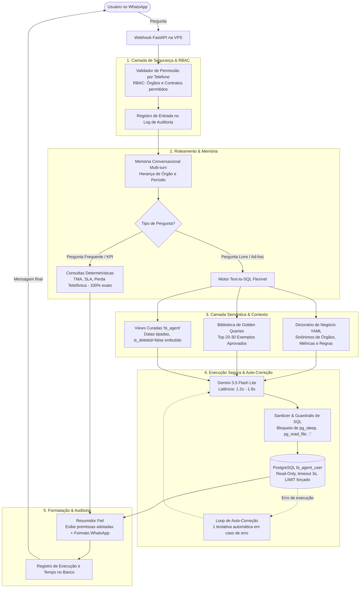
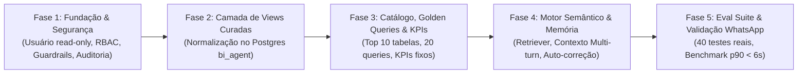

# Plano de Inteligência e Arquitetura do Agente WhatsApp BI (v2.0 Revisado)

## 1. Visão Geral & Objetivos
Construir uma camada de inteligência corporativa para o agente de WhatsApp que transforme perguntas em linguagem natural em insights confiáveis sobre a base `dw_positivo` (49 tabelas/views), garantindo:
- **Segurança de dados e conformidade com LGPD** (controle multi-órgão, read-only restrito e auditoria completa);
- **Consistência matemática e semântica** (zero alucinação em regras de negócio e SLAs);
- **Latência conversacional adequada** (p90 < 6s fim a fim no WhatsApp);
- **Evolução contínua orientada a avaliação** (suíte de testes automatizada e ciclo de feedback).

---

## 2. Arquitetura da Solução



---

## 3. Detalhamento dos Pilares Técnicos

### Pilar 1: Segurança, RBAC por Órgão e Auditoria (LGPD)
Como o `dw_positivo` armazena dados de múltiplos órgãos públicos (PRF, DPU, DNIT, FNDE, CAESB, MJ, etc.), a segurança é tratada como fundação:

1. **Usuário PostgreSQL Dedicado (`bi_agent_user`):**
   - Permissões estritas de `CONNECT` e `SELECT` apenas nas views curadas e tabelas de leitura.
   - Proibição de acesso ao schema `information_schema`, tabelas de usuários do GLPI ou tabelas internas do Postgres.
   - Parâmetro no banco: `SET statement_timeout = '3000ms'`.
2. **Hardening de SQL (Código + Banco):**
   - Validador AST/Regex que rejeita terminantemente:
     - Múltiplos statements (qualquer ponto-e-vírgula adicional);
     - Funções perigosas: `pg_sleep`, `pg_read_file`, `pg_ls_dir`, `pg_stat_activity`, `dblink`, etc.;
     - Bloqueio de subqueries recursivas descontroladas.
   - Injeção forçada de `LIMIT 50` em qualquer query gerada sem agregação.
3. **Controle de Acesso por Usuário (RBAC no WhatsApp):**
   - Mapeamento configurável no arquivo `app/config/rbac.json`:
     ```json
     {
       "556198379503": { "role": "admin", "allowed_scopes": ["*"] },
       "556199999999": { "role": "gestor_prf", "allowed_scopes": ["dprf"] },
       "556188888888": { "role": "gestor_incra", "allowed_scopes": ["incra"] }
     }
     ```
   - Se um usuário com escopo `dprf` perguntar *"Quantos chamados abertos no Incra?"*, o agente barra a execução antes de chamar o modelo:  
     > *"🔒 Seu acesso está configurado para consultas do contrato PRF. Você não possui permissão para visualizar dados do INCRA."*
4. **Log de Auditoria Estruturado:**
   - Tabela dedicada `dw_positivo.bi_agent_audit_log`:
     - `id`, `timestamp`, `phone_number`, `user_question`, `resolved_scope`, `generated_sql`, `execution_time_ms`, `success`, `row_count`, `error_message`.
   - Permite auditoria imediata de conformidade, extração de métricas de uso e revisão de segurança.

---

### Pilar 2: Camada de Views Curadas (`dw_positivo.vw_bi_*`)
A maior causa de erro em Text-to-SQL é a complexidade das tabelas brutas (datas em string no Cervello, flags de soft-delete no GLPI, nomenclaturas legadas com caracteres especiais).  
Para mitigar isso de forma definitiva, criaremos **views curadas** no PostgreSQL:

1. **`vw_bi_chamados_incra`** (baseada em `tb_cervello_chamados_incra`):
   - Converte `"Data_de_Abertura_Sem_Formato"` para coluna nativa `data_abertura (timestamp)`;
   - Normaliza nomes de colunas para `snake_case` (sem maiúsculas com acento ou aspas necessárias);
   - Cria coluna padronizada `fl_dentro_sla (boolean)`.
2. **`vw_bi_glpi_tickets`** (baseada em `tb_glpi_ticket`):
   - Já embutido na view: `WHERE is_deleted = false`;
   - Colunas normalizadas: `ticket_id`, `contrato_operacao`, `titulo`, `data_abertura`, `data_resolucao`, `status`, `prioridade`.
3. **Views Curadas por Órgão (`vw_bi_tickets_prf`, `vw_bi_tickets_caesb`, etc.)**:
   - Facilita enormemente o SQL que o LLM precisa gerar: um simples `SELECT count(*) FROM vw_bi_tickets_prf WHERE status = 'novo'` resolve 90% das dúvidas sem joins complexos.
4. **`vw_bi_telefonia_resumo`** (baseada em atendidas e perdidas):
   - View consolidada por dia/mês unificando contagem de atendidas, perdidas e tempo médio de espera.

---

### Pilar 3: Retriever Híbrido & Roteador de Consultas

1. **Abordagem Híbrida (Consultas Determinísticas para Top KPIs):**
   - Para as 8 a 10 perguntas mais recorrentes da diretoria e operação, não há necessidade de arriscar Text-to-SQL:
     - *TMA do mês por contrato*;
     - *Taxa de abandono/perda telefônica*;
     - *Volume de chamados abertos hoje por órgão*;
     - *Índice de cumprimento de SLA*.
   - Essas perguntas são detectadas por regras determinísticas/regex e executam **queries parametrizadas pré-testadas e auditadas**. Garantia de 100% de precisão e 0,2s de latência.
2. **Retriever Semântico para Perguntas Ad-hoc (Fase 1 e 2):**
   - **Fase 1 (Determinística + Dicionário de Sinônimos):**
     - Mapeia termos do usuário para o schema e view corretos via `data_catalog.yaml`.  
       *Ex: "policia rodoviaria", "prf", "patrulha" ➔ `vw_bi_tickets_prf`*.
   - **Fase 2 (Similaridade com Golden Queries):**
     - Mecanismo leve de busca de similaridade (BM25 ou Embeddings leves com o Qdrant que já roda na VPS) para recuperar as 2 queries de exemplo mais adequadas.

---

### Pilar 4: Mitigação de Erros Semânticos & Transparência

Uma query pode ser perfeitamente válida no PostgreSQL, mas semanticamente incorreta (ex: interpretar "chamados deste mês" como os últimos 30 dias móveis em vez do mês civil).

1. **Exibição Obrigatória de Premissas (Transparência Conversacional):**
   - Toda resposta do agente incluirá um rodapé sucinto deixando explícito como ele interpretou a solicitação:
     > 📋 **Resposta:** Foram abertos **142 chamados** da PRF.  
     > 🔍 *Critérios aplicados: Órgão: PRF | Período: 01/10/2026 a 07/10/2026 | Status: Todos | Excluídos: Não.*
   - Se o usuário notar que a premissa adotada não era o que ele queria, ele pode corrigir imediatamente (*"Não, quero apenas os chamados com status fechado"*).
2. **Regras Temporais Padronizadas no Catálogo:**
   - "Hoje": `CURRENT_DATE`.
   - "Este mês": do primeiro dia do mês corrente até a data atual (`DATE_TRUNC('month', CURRENT_DATE)`).
   - "Mês passado": mês anterior fechado completo.
   - "Em aberto": status que não sejam 'FECHADO', 'RESOLVIDO' ou 'CANCELADO'.
3. **Desambiguação Ativa:**
   - Se a pergunta for excessivamente vaga (*"Quantos chamados foram abertos?"* sem citar órgão ou sistema), o agente responde solicitando desambiguação em vez de chutar uma tabela.

---

### Pilar 5: Memória de Conversa Multi-Turn
Para conversas naturais no WhatsApp (*"Quantos chamados abertos no Incra este mês?"* ➔ *"E quantos foram de hardware?"*):
- O agente mantém um estado de sessão em memória (Redis/cache local por 15 minutos por telefone) armazenando:
  - `active_scope`: Ex: `incra`
  - `active_period`: Ex: `2026-10-01 a 2026-10-07`
  - `last_table`: Ex: `vw_bi_chamados_incra`
- Na mensagem seguinte, se o usuário não especificar um novo órgão ou período, o contexto anterior é herdado automaticamente.

---

### Pilar 6: Metas de Latência Reais & Feedback Visual
A meta de latência do sistema é ajustada para a realidade da cadeia de execução:

| Etapa | Tempo Estimado |
| :--- | :--- |
| Handshake Webhook + RBAC + Roteador | ~0.1s |
| Geração de SQL (Gemini Flash Lite) | 1.2s - 1.8s |
| Execução SQL no PostgreSQL VPS | 0.05s - 0.2s |
| Formatação e Resumo Conversacional | 1.2s - 1.6s |
| Envio WhatsApp Cloud API | ~0.3s |
| **Total Nominal (Cenário Padrão)** | **~3.0s - 4.0s** |
| Auto-Correção (se houver erro sintático / 1 retry) | + 1.5s (~5.5s) |

* **Meta de Aceite:** **p90 < 6 segundos**.
* **Feedback ao Usuário:** Como o processamento pode levar de 3 a 5 segundos, o agente imediatamente dispara o evento de *"Digitando..."* (`typing_indicator`) no WhatsApp via Graph API assim que recebe a mensagem, mantendo a experiência fluida.

---

### Pilar 7: Suíte de Avaliação Contínua (Eval Suite) & Ciclo de Feedback

1. **Conjunto de Testes Automatizados (Ground Truth de 40+ Perguntas):**
   - Criar arquivo `tests/eval_suite.json` com perguntas reais e seus resultados numéricos esperados auditados (ex: `{"pergunta": "...", "esperado_contagem": 28321}`).
   - Script `python -m tests.run_eval` que executa todas as perguntas contra o banco e afere a taxa de sucesso baseada na **exatidão do resultado retornado** (e não na comparação de strings do SQL).
   - Nenhuma alteração de prompt, catálogo ou view vai para produção se a taxa de acerto do Eval cair.
2. **Ciclo de Feedback & Aprendizado Ativo:**
   - Mensagens com erro ou exceções são salvas na tabela de auditoria com flag `needs_review = true`.
   - Consultas validadas pela equipe de dados em produção podem ser promovidas diretamente para a biblioteca de *Golden Queries*.

---

## 4. Ordem e Fases de Implementação



### Fase 1: Fundação de Segurança & Auditoria
- Criar usuário PostgreSQL `bi_agent_user` com permissões restritas.
- Criar tabela `dw_positivo.bi_agent_audit_log`.
- Implementar validador de guardrails (`statement_timeout = 3s`, bloqueio de funções do sistema e `;`).
- Implementar controle de acesso por número de telefone (`app/config/rbac.json`).

### Fase 2: Views Curadas (`dw_positivo.vw_bi_*`)
- Criar script DDL com as primeiras 6 a 8 views curadas focadas nos principais órgãos e sistemas:
  - Cervello INCRA (datas padronizadas);
  - GLPI Geral e views de órgãos frequentes (PRF, CAESB, DPU, UFBA);
  - Telefonia (atendidas vs perdidas).

### Fase 3: Catálogo Semântico, Golden Queries e KPIs Determinísticos
- Criar `app/knowledge/data_catalog.yaml` cobrindo o vocabulário dessas views e termos de negócio.
- Criar `app/knowledge/golden_queries.json` com 20 pares aprovados de Pergunta -> SQL.
- Implementar execução determinística para os 5 principais KPIs corporativos.

### Fase 4: Retriever, Auto-Correção e Memória Conversacional
- Implementar `app/retriever.py` com matching de sinônimos e injeção contextual enxuta.
- Atualizar `app/agent.py` para suportar memória de sessão multi-turn e auto-correção de 1 ciclo.
- Implementar rodapé de transparência com as premissas adotadas.

### Fase 5: Suíte de Avaliação (Eval Suite) e Homologação Fim a Fim
- Desenvolver suíte de avaliação com 40 perguntas reais verificando igualdade de dados.
- Homologar latência p90 < 6s e testes interativos no WhatsApp.
