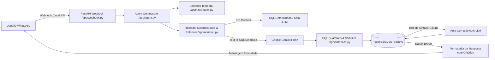

# 🤖 Agente WhatsApp BI & Data Intelligence (Datavizbi)

Assistente corporativo e conversacional integrado ao **WhatsApp Business Cloud API**, desenvolvido em **Python (FastAPI)** com arquitetura **Text-to-SQL**, camada semântica com auto-correção, roteamento determinístico de KPIs e introspecção dinâmica de catálogo no banco de dados **PostgreSQL (DW Positivo)**.

---

## 🏛️ Visão Geral da Arquitetura

O agente permite que diretores, gerentes e analistas façam perguntas em linguagem natural pelo WhatsApp (ex: *"Quantos chamados foram solucionados no DNIT na última sexta?"*) e recebam respostas imediatas, consolidadas e auditáveis, baseadas nas bases de dados de contratos públicos (DNIT, PRF, DPU, FNDE, MJ, INCRA, UFBA, CAESB, etc.).



---

## 🚀 Principais Funcionalidades

1. **Contexto Temporal Robusto (`app/utils/dates.py`)**:
   - Resolução precisa de datas relativas no fuso horário de Brasília (`America/Sao_Paulo`).
   - Calcula em código datas como *"última sexta-feira"*, *"semana passada"*, *"este mês"*, injetando datas ISO no prompt para eliminar alucinações de ano ou cálculos com intervalos incorretos.

2. **Poda Semântica de Schema (`app/retriever.py`)**:
   - Identifica o órgão/escopo da pergunta via sinônimos e palavras-chave.
   - Fornece no prompt da LLM apenas as views relevantes com colunas reais introspectadas dinamicamente via catálogo do PostgreSQL (`information_schema.columns`).
   - Regras semânticas estritas que proíbem colunas inventadas (`fl_solucionado`, `dt_abertura`) e definem o significado de `data_solucao`, `data_fechamento` e `fl_encerrado`.

3. **Arquitetura Híbrida & Golden Queries**:
   - KPIs rotineiros e de alto volume são resolvidos instantaneamente por roteamento determinístico.
   - Banco de exemplos (`golden_queries.json`) utilizado para *few-shot learning* contextual.

4. **Segurança & Guardrails Estritos (`app/database.py`)**:
   - Conexão com usuário PostgreSQL dedicado de leitura (`bi_agent_user`).
   - Bloqueio rigoroso de múltiplos comandos SQL (`;`), injeção SQL, comandos de escrita/DDL (`INSERT`, `UPDATE`, `DROP`, `TRUNCATE`) e funções do sistema (`pg_sleep`, `pg_read_file`).
   - `statement_timeout` forçado em 8 segundos e `LIMIT 50` compulsório.
   - Lista branca de números autorizados (`ALLOWED_NUMBERS`).

5. **Auditoria LGPD & Rastreabilidade**:
   - Toda consulta gera um registro na tabela `dw_positivo.bi_agent_audit_log`, gravando número do solicitante, pergunta, SQL gerado, tempo de resposta em milissegundos, taxa de sucesso, erro técnico e contexto temporal utilizado.

6. **Transparência na Resposta**:
   - O agente sempre anexa ao final da mensagem uma nota de transparência informando os critérios e filtros aplicados:
     > _🔍 Critérios: Órgão: DNIT | Período: 2026-10-09 | Status: Solucionados_

---

## 📁 Estrutura do Projeto

```
wapp/
├── app/
│   ├── __init__.py
│   ├── config.py              # Configurações e variáveis de ambiente (Pydantic Settings)
│   ├── database.py            # Sanitizador de SQL, execução segura e auditoria
│   ├── agent.py               # Orquestrador do agente, chamadas LLM e auto-correção
│   ├── webhook.py             # Endpoints FastAPI para validação e recepção do WhatsApp
│   ├── knowledge/
│   │   ├── data_catalog.yaml  # Dicionário de sinônimos e regras de negócio
│   │   └── golden_queries.json# Biblioteca de exemplos curados para few-shot
│   ├── retriever.py           # Classificador de escopo, retriever de schema e KPIs
│   └── utils/
│       ├── __init__.py
│       └── dates.py           # Construtor de contexto temporal (ZoneInfo America/Sao_Paulo)
├── migrations/
│   └── 01_create_bi_views.sql # DDL das views curadas e tabela de auditoria
├── tests/
│   ├── test_dates.py          # Testes unitários de contexto temporal (casos de borda)
│   ├── eval_suite.json        # Casos de teste de precisão temporal e semântica
│   ├── run_eval.py            # Runner de avaliação de acurácia contra o PostgreSQL
│   └── eval_suite.py          # Avaliação de precisão de KPIs corporativos
├── docker-compose.yml         # Orquestração do container Docker
├── Dockerfile                 # Construção da imagem Python com FastAPI
├── requirements.txt           # Dependências do projeto
├── .env.example               # Exemplo de variáveis de ambiente
└── README.md                  # Documentação do projeto
```

---

## 🛠️ Tecnologias Utilizadas

- **Linguagem:** Python 3.11+
- **Framework Web:** FastAPI / Uvicorn
- **Banco de Dados:** PostgreSQL 16 (DW Positivo) com `psycopg2-binary`
- **Modelos de Linguagem (LLM):** Google Gemini Flash / Gemini Flash Lite via API REST
- **Infraestrutura:** Docker, Docker Compose, Nginx Reverse Proxy
- **Mensageria:** Meta WhatsApp Business Cloud API (Graph API v21.0)

---

## ⚙️ Configuração e Execução

### 1. Clonar o Repositório e Instalar Dependências

```bash
git clone https://github.com/lscleriston/wapp.git
cd wapp
python -m venv venv
source venv/bin/activate  # No Windows: venv\Scripts\activate
pip install -r requirements.txt
```

### 2. Configurar Variáveis de Ambiente

Crie o arquivo `.env` baseado no `.env.example`:

```bash
cp .env.example .env
```

Preencha as credenciais da Meta (`WHATSAPP_TOKEN`, `WHATSAPP_PHONE_NUMBER_ID`, `WHATSAPP_VERIFY_TOKEN`), as credenciais do PostgreSQL (`PG_USER`, `PG_PASSWORD`, etc.) e a chave de API do Gemini (`GEMINI_API_KEY`).

### 3. Execução Local

```bash
uvicorn app.webhook:app --host 0.0.0.0 --port 8005 --reload
```

### 4. Execução com Docker

```bash
docker compose up -d --build
```

---

## 🧪 Testes e Avaliação

### Testes Unitários de Datas e Fuso Horário
Valida a lógica temporal em terças, domingos, viradas de mês e viradas de ano:
```bash
python -m unittest tests.test_dates
```

### Avaliação de Precisão Text-to-SQL (Eval Suite)
Executa perguntas contra o agente e compara o resultado obtido com consultas de referência no banco de dados real:
```bash
python -m tests.run_eval
```

---

## 📄 Licença

Projeto desenvolvido para uso corporativo interno e gestão de inteligência de dados da Datavizbi.
